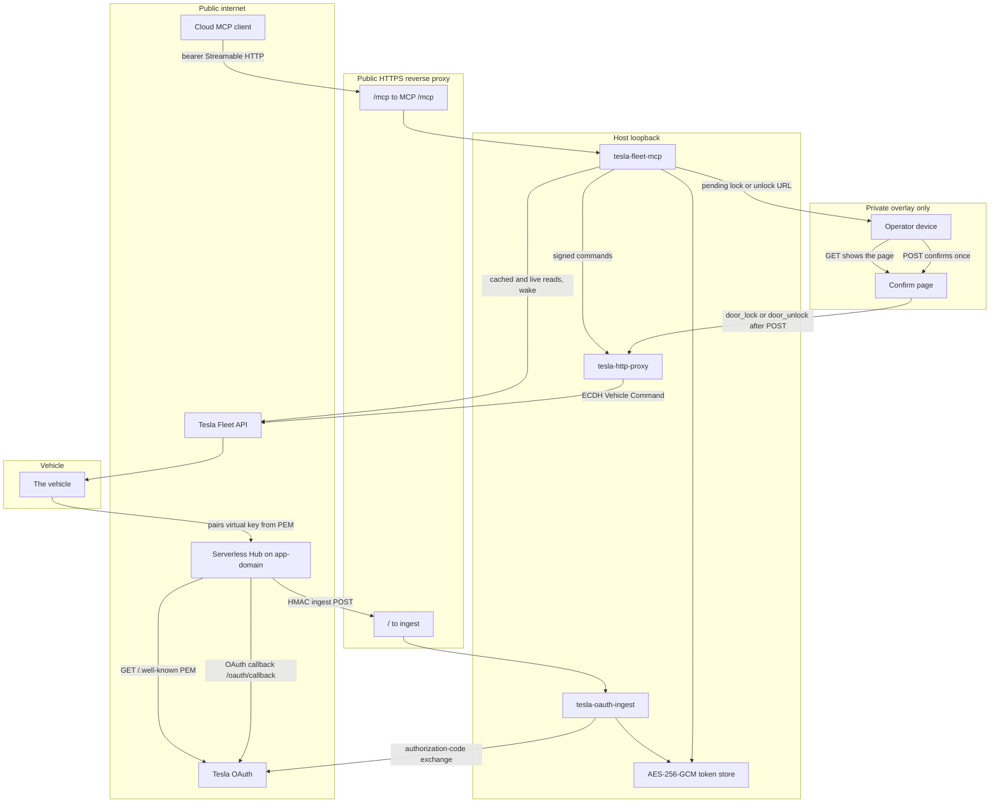
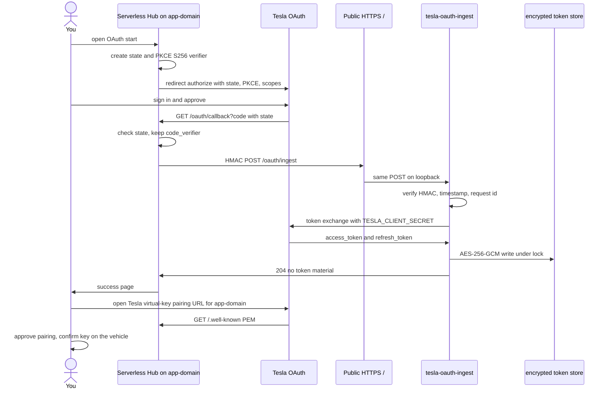
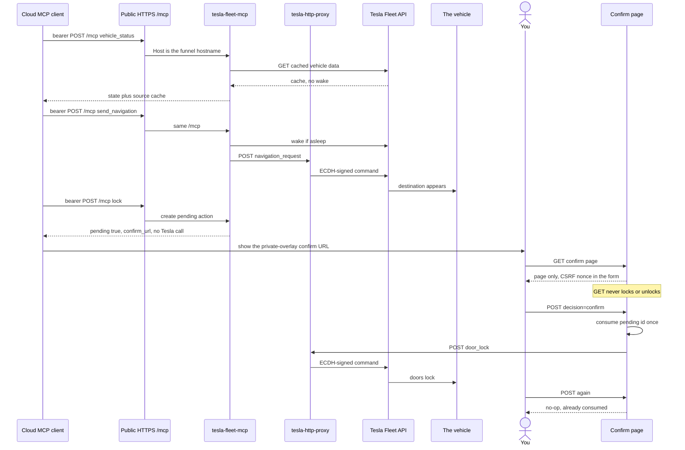

# How Tesla Fleet MCP fits together

This page explains the v1 reference architecture: who talks to whom, which trust zone each hop lives in, and why the shape is awkward. It is not a setup guide for a private deployment.

This public repository ships a minimal Streamable HTTP MCP server with mock vehicle responses so you can explore the tool surface locally. A production deployment still needs Tesla Fleet API credentials, a signing proxy, and encrypted token storage on hardware you control.

## What you are looking at

`tesla-fleet-mcp` is a Streamable HTTP [MCP](https://modelcontextprotocol.io) server that typically runs on a single-board computer you control. Cloud assistants cannot dial a private overlay network or loopback. They call a public HTTPS `/mcp` URL with a bearer token.

The host holds Tesla OAuth tokens and the command-signing private key. Vehicle reads go to Tesla Fleet API. Signed commands go through Tesla's `tesla-http-proxy`. The vehicle is the only thing that moves.

A full v1 deployment exposes three public surfaces, and only those three:

1. A small serverless web app on `<app-domain>`. It serves the Tesla virtual-key PEM and the OAuth start plus callback pages.
2. A public HTTPS reverse proxy (for example Tailscale Funnel) on `<funnel-host>`. Path `/` reaches oauth-ingest. Path `/mcp` reaches the MCP server.
3. Nothing else. The lock and unlock confirm page stays on the private overlay. `tesla-http-proxy` stays on loopback.

## Trust zones and system boundary

Traffic crosses four zones. Public internet, the public reverse proxy, host loopback, and the private overlay are not interchangeable. A cloud MCP client never reaches the confirm page. The public reverse proxy never reaches the signing proxy.

`<app-domain>` is the Tesla developer-app domain. `<funnel-host>` is a different public hostname for MCP and ingest. Tesla fetches the PEM over the public internet during partner registration and virtual-key pairing. The reverse-proxy hostname is separate on purpose.

The MCP process still binds loopback. The reverse proxy often keeps the public `Host` header, so an allowlist such as `MCP_ALLOWED_HOSTS` must list `<funnel-host>`. Unknown hosts stay rejected. Bearer checks still run after Host and Origin checks.

## One-time setup and OAuth

Tesla will not issue vehicle commands until three facts are true. The app domain serves a P-256 public key at a fixed well-known path. You complete an authorization-code login. The vehicle has the matching virtual key on its Locks screen.

The login cannot keep `TESLA_CLIENT_SECRET` on a serverless Hobby plan. Hobby has no always-on disk and is the wrong place for a refresh token that rotates. Hub therefore keeps only `TESLA_CLIENT_ID`, PKCE, and the HMAC ingest secret. The host keeps the client secret and the encrypted token file.

Hub never stores access or refresh tokens. The ingest POST body has the authorization code, the PKCE verifier, and the redirect URI `https://<app-domain>/oauth/callback`. It does not contain `client_secret`. HMAC covers timestamp, request id, and the raw JSON body. The host rejects a stale timestamp or a bad signature.

After a later refresh, the MCP server writes the new refresh token first, then the new access token, under the same lock file ingest uses.

## Steady-state tools and door confirmation

Once tokens exist, a cloud MCP client lists seven tools: `send_navigation`, `vehicle_status`, `charge_status`, `climate_on`, `climate_off`, `lock`, and `unlock`. There is no `approve` tool. The assistant cannot confirm its own door command.

Cached status is the cheap path. `vehicle_status` and `charge_status` default to `live=false`. That path reads cached vehicle data and never wakes the vehicle. Set `live=true` only when you want a fresh read. That path may wake the vehicle and counts against a local wake cap.

Navigation and climate are signed commands. The MCP server wakes if the vehicle is asleep, then POSTs through `tesla-http-proxy` on loopback. The proxy is a long-running Go process. It completes an ECDH handshake with the vehicle using the virtual key and forwards the command.

Lock and unlock do not call Tesla from the MCP tool. They create a pending action and return a confirm URL on the private overlay.

Chat apps prefetch GET links. That is why GET only renders HTML. The form POST carries a CSRF nonce that GET does not put in the URL. The first successful POST consumes the pending id. A second POST is a no-op. Pending actions expire after five minutes.

The confirm listener must stay off the public reverse proxy. Open confirm URLs from a device on the private overlay. Funnel configuration should fail closed if it would publish the confirm listener, the signing proxy, or any other unexpected service.

## Why v1 has this many moving parts

Some of this is Tesla, serverless Hobby limits, and MCP clients. Some of it is how v1 was assembled. The second group is the debt to collapse later.

### Constraints imposed from outside

These are essential. v2 still has to live with them.

1. Tesla Fleet API requires an ECDSA P-256 public key at `https://<app-domain>/.well-known/appspecific/com.tesla.3p.public-key.pem`. Vehicle commands need an ECDH signature through `tesla-http-proxy`. That proxy is a persistent Go process. It cannot run on serverless Hobby.
2. Tesla's authorization-code flow needs a stable public HTTPS redirect URI. Keeping `TESLA_CLIENT_SECRET` and refresh tokens off serverless infrastructure means Hub must forward the one-time auth code to the host that stores tokens.
3. Cloud AI MCP clients need a public HTTPS Streamable HTTP endpoint with bearer authentication. They cannot dial a private overlay or loopback.
4. Physical safety for `lock` and `unlock` needs a human confirmation outside the MCP tool surface. Prompt injection must not move door locks. Link prefetching on GET must not move them either.

### Self-inflicted v1 scaffolding

These are accidental. They exist because milestones landed one at a time and left earlier services untouched.

1. `tesla-oauth-ingest` and `tesla-fleet-mcp` often run as two Node HTTP processes and two service units. They share the encrypted token file through a lock file. Confirm listens on a third listener in the MCP process. v2 can be one Node daemon with separate routes and listeners.
2. Public ingress is split. The serverless app serves `/oauth/*` and `/.well-known/*`. The reverse proxy serves `/` to ingest and `/mcp` to MCP. Path-stripping reverse proxies and Host allowlisting showed up late in v1, not at the start.
3. Setup is several milestone-numbered runbooks instead of one deployment path.

v1 is the system that production operators run. Treat the first list as physics. Treat the second list as homework for v2.

## What this public repository includes

- This architecture page with the three Mermaid diagrams above.
- A minimal Streamable HTTP MCP entry point under `src/` that registers the seven v1 tool schemas against a `VehicleBackend` interface.
- A safe offline mock backend so `npm install && npm test && npm start` needs no Tesla credentials.
- Secret-scanning standard v1 scaffolding.

It does not include operator runbooks, private hostnames, account identifiers, PEM material, or a live Fleet API adapter.
